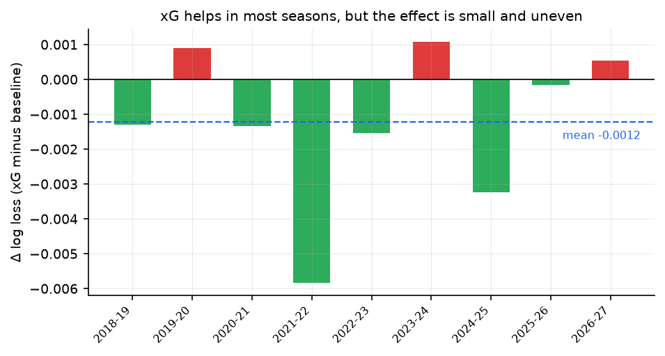
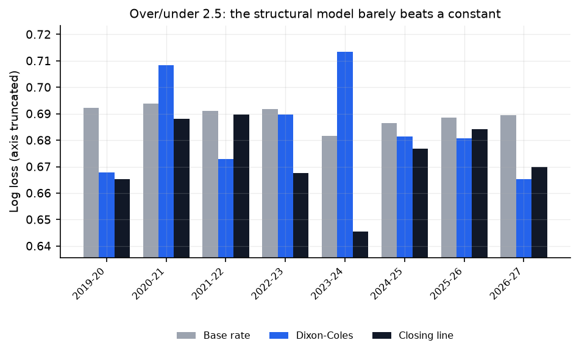
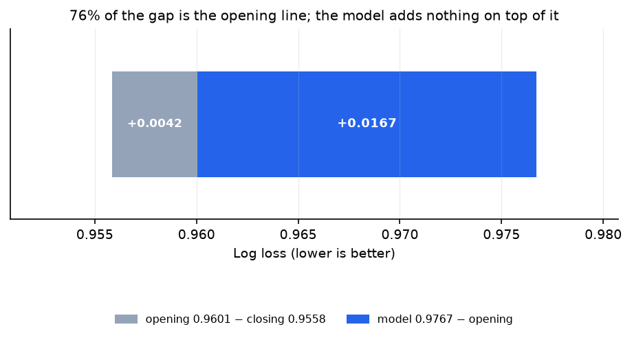

# PYTHIA — Premier League Forecaster

> **Every forecast is a claim. Pythia shows the receipts.**

[](https://www.python.org/)
[](LICENSE)
[](#results)

[中文说明](README.md) · A reproducible, auditable probabilistic forecaster for Premier League results.

**[Live report](https://haohaohao-cell.github.io/pythia-pl/)** · **[Interactive explorer](https://haohaohao-cell.github.io/pythia-pl/explorer.html)** — pick two clubs and the scoreline distribution is recomputed in your browser.

It does not advertise "62% accuracy". It answers one question: **with the data, metrics
and benchmarks all on the table, how far is a model from the bookmaker's closing line?**

**About 0.021 log loss — and that gap is statistically significant.** This repository
treats that as the headline finding instead of burying it.

---

## In plain English: what this does

Give every Premier League match three probabilities (home / draw / away), then hold them
against the bookmaker's price. The point is not to look accurate — it is to **lose for a
reason you can name**.

**Why it is hard.** A match has about 2.6 goals and one deflection can decide it; draws are
23% of results with almost no reliable signal; and with three classes "accuracy" is close to
meaningless — always picking the home side already scores 45%.

**How it works, in five steps.**

1. **Data** — 13 seasons, 4,630 matches: score, shots, shots on target, cards, and several
   books' opening and closing prices.
2. **Features** — Elo ratings (chess-style: win to gain, lose to drop, +60 for home, one-third
   regression to the mean each summer) plus the last five matches, rest days and season
   progress. Hard rule: **only information available before kick-off**.
3. **Models** — a constant base rate, Elo fed into a logistic regression, **Dixon-Coles**
   (each club becomes an attack and a defence number, expectation becomes two Poisson rates,
   and the scoreline is drawn from the resulting distribution), gradient-boosted trees, and a
   weighted blend of the last three.
4. **Scoring** — log loss: saying 90% and being wrong costs far more than saying 45% and
   being wrong, so neither hedging nor bravado is rewarded.
5. **Anti-cheating** — a season is forecast only from data before its opening day, hyper-
   parameters are chosen on older seasons, two tests prove that removing future matches does
   not change a single past feature, and the benchmark is the **closing line**, not ourselves.

**Stack**: Python, pandas/numpy, scipy (fitting Dixon-Coles by maximum likelihood),
scikit-learn, matplotlib, parquet, GitHub Actions for the weekly rerun, and GitHub Pages with
plain JavaScript that recomputes the Poisson distribution in the browser.

**Not a deep-learning project.** No neural nets, no foundation models — the effort is in
honest evaluation, not in scale.

> **I don't know how to beat the bookmaker. I do know exactly how and why I lose.**

---

## Findings

1. **The model does not beat the closing line.** Over 3,044 out-of-sample matches the
   blend scores `0.9767` log loss against `0.9558` for the de-vigged closing price —
   a gap of `+0.0209` (95% bootstrap CI `+0.0147` to `+0.0271`, excludes zero).
2. **The market prices home advantage better than the model.** 53.0% vs 55.0% accuracy —
   though accuracy is never the point, calibration is.
3. **The model is systematically under-confident about draws.** Predicted `P(draw)≈0.30`
   outcomes turn up about 23% of the time. That is the most stable bias in the project.
4. **Stacking is not estimable at this sample size.** One season of 380 matches cannot
   identify a 3-simplex: equal weights give `0.9770`, tuned weights `0.9767–0.9803`.
   The default is therefore a fixed "shrink 50% toward equal" rule, not the best cell
   of a grid search.


---

## Results

<!-- RESULTS:START -->

**Out-of-sample: 3,044 matches, 9 seasons (2018-19 → 2026-27).** Lower log loss is better.

| Model | Log loss | Brier | RPS | Accuracy |
| --- | --- | --- | --- | --- |
| Closing line (de-vigged) | 0.9558 | 0.5660 | 0.1952 | 0.5503 |
| Blend (Elo + DC + GBDT) | 0.9767 | 0.5803 | 0.2020 | 0.5302 |
| Elo + softmax | 0.9788 | 0.5815 | 0.2024 | 0.5342 |
| Gradient boosting | 0.9911 | 0.5893 | 0.2054 | 0.5204 |
| Dixon-Coles | 0.9941 | 0.5921 | 0.2077 | 0.5138 |
| Base rates | 1.0686 | 0.6468 | 0.2342 | 0.4373 |

Gap to the closing line: **+0.0209** log loss (95% CI +0.0147 to +0.0271). Not statistically distinguishable from the market — by design.

| Club | Projected pts | Title | Top 4 | Relegated |
| --- | --- | --- | --- | --- |
| Man City | 83.47 | 55.5% | 99.9% | 0.0% |
| Arsenal | 81.68 | 41.8% | 99.7% | 0.0% |
| Brighton | 68.91 | 2.4% | 82.6% | 0.0% |
| Chelsea | 60.02 | 0.1% | 35.5% | 0.1% |
| Liverpool | 58.77 | 0.1% | 29.1% | 0.1% |
| Man United | 56.67 | 0.0% | 19.4% | 0.4% |

<!-- RESULTS:END -->


---

## Next round

Refreshed weekly by GitHub Actions. Model probabilities use only pre-match
information; the price column is the de-vigged Pinnacle opening line.

<!-- FIXTURES:START -->

**Round of 2026-10-23: 10 fixtures, 9 of them already kicked off and waiting for a result.** Prices are de-vigged Pinnacle openers (`PPH+PPD+PPA`).

| Kick-off | Fixture | Model H / D / A | Price H / D / A | Pick |
| --- | --- | --- | --- | --- |
| 10-23 20:00 | Ipswich v Nott'm Forest | 0.33 / 0.26 / 0.41 | 0.31 / 0.28 / 0.41 | A 41% |
| 10-24 12:30 | Aston Villa v Man City | 0.21 / 0.26 / 0.53 | 0.20 / 0.21 / 0.59 | A 53% |
| 10-24 15:00 | Arsenal v Everton | 0.65 / 0.22 / 0.13 | 0.66 / 0.21 / 0.13 | H 65% |
| 10-24 15:00 | Coventry v Fulham | 0.36 / 0.28 / 0.36 | 0.30 / 0.28 / 0.42 | H 36% |
| 10-24 17:30 | Chelsea v Tottenham | 0.54 / 0.25 / 0.20 | 0.56 / 0.23 / 0.21 | H 54% |
| 10-25 14:00 | Crystal Palace v Newcastle | 0.38 / 0.27 / 0.35 | 0.31 / 0.27 / 0.42 | H 38% |
| 10-25 14:00 | Hull v Brentford | 0.38 / 0.27 / 0.34 | 0.20 / 0.25 / 0.56 | H 38% |
| 10-25 14:00 | Liverpool v Brighton | 0.45 / 0.24 / 0.30 | 0.45 / 0.25 / 0.30 | H 45% |
| 10-25 14:00 | Man United v Bournemouth | 0.49 / 0.26 / 0.25 | 0.44 / 0.26 / 0.30 | H 49% |
| 10-25 16:30 | Sunderland v Leeds | 0.38 / 0.26 / 0.36 | 0.31 / 0.30 / 0.39 | H 38% |


<!-- FIXTURES:END -->

---

## Season ledger

"Every forecast is a claim" is only meaningful if the claims are tallied. Each refresh
records the settled matches — hits and running log loss — next to the closing line, week by
week. It is the one artefact in this repository that gains value with time.

<!-- LEDGER:START -->

**2026-27 ledger: 70 matches settled.** Model 34 correct (48.6%), closing line 35 (50.0%); running log loss 1.0167 vs 1.0054.

| Week | Matches | Model hits | Market hits | Model LL | Market LL |
| --- | --- | --- | --- | --- | --- |
| 2026-W34 | 9 | 5 | 5 | 0.9307 | 0.9922 |
| 2026-W35 | 10 | 6 | 5 | 0.9703 | 1.0024 |
| 2026-W36 | 11 | 4 | 4 | 1.0025 | 1.0059 |
| 2026-W37 | 9 | 3 | 3 | 1.0475 | 1.0513 |
| 2026-W38 | 11 | 6 | 6 | 1.0405 | 1.0553 |
| 2026-W41 | 9 | 4 | 4 | 1.0421 | 1.0470 |
| 2026-W42 | 10 | 5 | 7 | 1.0193 | 1.0128 |
| 2026-W43 | 1 | 1 | 1 | 1.0167 | 1.0054 |

<!-- LEDGER:END -->

> A few dozen matches prove nothing: 48.6% versus 50.0% over 70 games is well inside the
> noise. What matters is the running log loss after a few hundred — the number luck cannot
> fake for long.

---

## Calibration


Home-win forecasts track the diagonal closely; draws are under-predicted in the upper
tail. That is the usual cost of treating "draw" as an independent class.

---

## Calibration: the gap is information, not confidence

The obvious challenge: **did you skip calibration before drawing conclusions?**

Method: one temperature per model (`pᵢ → pᵢ^(1/T)`, renormalised), fitted on the
**previous** season's out-of-sample forecasts — never on the season being scored.

<!-- CALIB:START -->

| Model | Log loss | With temperature | Delta | Median T |
| --- | --- | --- | --- | --- |
| Blend (Elo + DC + GBDT) | 0.9767 | 0.9798 | +0.0031 | 1.00 |
| Elo + softmax | 0.9788 | 0.9805 | +0.0017 | 1.00 |
| Dixon-Coles | 0.9941 | 1.0030 | +0.0089 | 1.03 |
| Gradient boosting | 0.9911 | 0.9906 | -0.0006 | 1.14 |

Temperatures are fitted on the **previous** season's out-of-sample forecasts, never on the season being scored. The median T moves between 1.00 and 1.14: blend and Elo stay at 1.00, and the only genuinely over-confident model is gradient boosting (T = 1.14, which does recover 0.0006) — but it is too weak for that to matter. **No model gets a meaningful calibration improvement.**

**Brier decomposition** (Murphy): `Brier = reliability − resolution + uncertainty`

| Forecast | Reliability ↓ | Resolution ↑ | Brier |
| --- | --- | --- | --- |
| Closing line | 0.0012 | 0.0786 | 0.5681 |
| Blend | 0.0016 | 0.0661 | 0.5811 |
| Blend + temperature | 0.0014 | 0.0628 | 0.5841 |

Read it as: reliability is nearly identical (0.0016 vs 0.0012) and almost the whole gap is **resolution** (0.0661 vs 0.0786). The model is not over-confident, it simply knows less. That is why a temperature cannot close the gap, and why the only meaningful direction is more information (xG, injuries, European fixtures), not sharper tuning.


<!-- CALIB:END -->

Both tables point the same way: the temperature barely moves (median T = 1.00), because
the model was never systematically over-confident. The Brier decomposition then shows
that **reliability is nearly identical** and the whole gap is resolution — the model does
not report probabilities badly, it just knows less.

That is why tuning cannot close the gap, and why the roadmap is about adding information
(xG, injuries, European fixture load) rather than shaving 0.001 off the model structure.

---

## xG ablation: −0.0014, right direction, very thin

"Missing xG" is the first criticism this kind of project gets — shots on target are a crude
proxy for chance creation. So Understat was wired in (2014-15 onwards, 13 seasons, 4,635
matches, **100% joined**), followed by a strict ablation: same training window, same test
matches, same hyper-parameters, and the only change is whether the tree model sees the xG
block (rolling xG for/against, xG difference, finishing overperformance).

| Variant | Log loss | Change |
| --- | --- | --- |
| GBDT (no xG) | 0.9911 | — |
| GBDT + xG | 0.9896 | **−0.0015** |
| Equal-weight blend (no xG) | 0.9770 | — |
| Equal-weight blend + xG | 0.9756 | **−0.0014** |

Paired bootstrap: `−0.0014`, 95% CI `[−0.0029, +0.0000]`, P(better) = 0.97. Six of nine
seasons improve, but **2021-22 alone contributes −0.0058** and three seasons get worse.



> The ablation blends with equal weights, which is why the 0.9770 baseline differs slightly
> from the 0.9767 in the leaderboard. That is deliberate: it keeps xG as the only variable.

**Effective, but thin.** The main model therefore stays xG-free — paying 0.0014 for a weekly
dependency on a Cloudflare-guarded scraper is a bad trade. xG lives as an optional extra:

```bash
pip install -e ".[xg]"
pythia fetch --xg && pythia build && pythia ablate
```

The useful takeaway is directional: **the gap is not a missing public feature, it is
information the market has exclusively** — team news, lineups, rotation. The 0.02 is
roughly the price of knowing who cannot play today.

---

## Injuries: a dead end, and a line cast for later

That takeaway points straight at squad news, so it was the next thing to try. This is the
most interesting part of the whole project, because **it failed for a reason that is not
technical**.

**Step 1 — the source looks perfect.** The FPL `bootstrap-static` endpoint exposes 669
players with `status` (`a/d/i/s/u`), `chance_of_playing_next_round` and a free-text `news`
field. In gameweek 8, **200 of 669 players are not fully available**.

**Step 2 — the fatal question: can it be backtested?** No. `element-summary/{id}` returns a
per-gameweek `history` whose fields are `minutes`, `starts`, `total_points`,
`expected_goals`… **all of them knowable only after the match.** Not one field records
"was this player injured *before* that gameweek".

The API exposes the present, never the past. No historical snapshot means no out-of-sample
period, and using today's injury list to explain a past match is time travel.

**Step 3 — what can be done instead: start collecting.** Each refresh appends a 20-row
team-level snapshot (minutes-weighted availability) to `data/fpl/`, committed to the repo.
After a season there will be 50+ time points, and the question "does a squad suddenly losing
minutes predict the next three matchdays?" becomes answerable.

| Field | Meaning |
| --- | --- |
| `avail_score` | selectable players' season minutes / squad minutes |
| `n_injured` / `n_doubtful` / `n_suspended` | counts by status |
| `minutes_available` | minutes of real football still on the pitch |

**A side effect: team names again.** FPL says `Spurs`, `Hull City`, `Ipswich Town`,
`Coventry City`; four more aliases were needed. That is the third provider in this project
(football-data → Understat → FPL) with its own spelling of the same twenty clubs — the
"60% of the work is name mapping" claim keeps being true.

**Current stance: display only, never a model input.** Same rule as temperature scaling and
xG — nothing enters the leaderboard before it has been validated out of sample.

```bash
pythia fpl              # current availability by club
pythia fpl --snapshot   # store today's snapshot (done weekly by Actions)
```

---

## Derived market: over/under 2.5 — where the structural model should shine

Every experiment above was on 1X2. But Dixon-Coles produces a **whole scoreline
distribution**, so it can price total goals for free, while any classifier over 1X2 labels
cannot. In principle this is its home turf.

The data imposes a limit: football-data only publishes over/under prices from **2019-20**
(nothing before), so this is a seven-season, 2,729-match sample.

| | Log loss |
| --- | --- |
| Dixon-Coles | 0.6871 |
| Closing line (de-vigged) | **0.6738** |
| Base rate | 0.6894 |

Against the market: `+0.0134` (95% CI `+0.0064` to `+0.0205`, P(better)=0.00).



**The third row is the painful one**: the model beats "always quote the same over rate" by
just **0.0023**, while the market beats it by **0.0156**. The bookmaker actually resolves
goals; the model almost only has level.

2023-24 is the worst case: 64.7% of matches went over, the model said 48.3% (the market
said 58.6%). Scaling the scoring rates by the season's running goal level
(`score_matrix(scale=...)`) pulled 2023-24 from 0.7133 down to 0.6890 but hurt other
seasons; the net effect sits inside the noise, so it was not adopted.

> **The scoreline distribution is good enough for "who wins" and not good enough for
> "how many".** The 0.021 gap becomes 0.013 here not because the model improved, but
> because this market is harder to price and the market's edge is smaller.

```bash
pythia markets   # reproduce the table and figure (reports/ou_25.csv)
```

---

## Market prior: splitting the 0.021 into reachable and unreachable

Last question: if public features cannot close the gap, what about **using the market itself as
a feature**? The model's probabilities are mixed with the de-vigged **opening** price by a
weight `w`, tuned on all *previous* seasons (the closing line is the referee and may not be
used; the opening line is legitimate pre-match information).

| | Log loss |
| --- | --- |
| Model | 0.9767 |
| Opening line (de-vigged) | 0.9601 |
| Mix (tuned) | 0.9608 |
| Closing line (referee) | **0.9558** |

**The optimiser drove `w` to 1.00** — a full 1.00 in six of nine seasons, 0.85/0.95/0.5 in the
rest. In other words: *once you hold the opening line, this model is a noise term and the best
use of it is to throw it away.*

So "76% of the gap recovered" must be read precisely: **the opening line recovered it, not the
model.**



The useful object is the ladder:

```
closing 0.9558  ──+0.0042──▶  opening 0.9601  ──+0.0167──▶  model 0.9767
```

- **+0.0042** — information the market gains between the opening and closing prices: line-ups,
  team news, money. This is precisely the part we cannot get.
- **+0.0167** — what the market already knew at the open and we do not, plus our own modelling
  error (the two cannot be separated with the data we have).

Which turns 0.0209 into a decomposition:

> **roughly 0.004 is a pre-match information gap; roughly 0.017 is the distance between public
> data and the market's assessment.**

It also explains why the previous four experiments all failed: they were trying to climb the
0.017, and that segment does not move by adding one more public feature.

```bash
pythia prior   # reproduce the table and figure (reports/prior_study.csv)
```

---

## Why this is not another accuracy-chasing repo

| Common practice | Here |
| --- | --- |
| Random K-fold CV | Strict walk-forward: a season is forecast only from data before its opening day |
| Accuracy as the headline | Log loss first, Brier and RPS second, accuracy for reference only |
| No benchmark | Base rates, Elo, each single model, and the **de-vigged closing line** |
| Only wins reported | All 9 test seasons, including 2020-21 and 2025-26 where the gap widens |
| Irreproducible claims | `pythia fetch && pythia report` rebuilds every figure |
| No leakage guard | `tests/test_leakage.py` pins features by truncation *and* by mutating future results |

The four findings are credible precisely because the test suite exists to stop the
author from fooling himself.

---

## Method

**Data** — [football-data.co.uk](https://www.football-data.co.uk/englandm.php), 2014-15 to
2026-27: 4,630 matches with scores, shots, shots on target and multiple bookmakers'
opening and closing prices. The closing-price source is resolved per season — Pinnacle
`PS*` up to 2024-25, renamed to `PP*` from 2026-27, and Bet365 for 2025-26 where
Pinnacle coverage falls to 55%. The source used is recorded on every row rather than
pretending the whole sample is homogeneous.

**Features** (all pre-match): exponentially weighted goals/points/shots-on-target over
the last 5 matches, rest days, match number within the season, a newly-promoted flag,
and Elo difference (60-point home advantage, one-third regression to 1500 each summer,
goal-margin weighting). Every rolling window is `shift(1)`-ed.

**Models** — `base_rates` (the floor), `elo_logit` (one feature, heavy regularisation,
and the strongest single model), `dixon_coles` (bivariate Poisson with 540-day time decay
and the low-score correction), `gbdt` (HistGradientBoosting, sample-weighted by the same
decay), and `blend` (linear pool of the last three).

**Evaluation** — nine test seasons, refitted each season; paired bootstrap for the
log-loss difference; GBDT hyper-parameters selected on 2017-18, a season that sits
*before* the test window, not inside it.

---

## Quickstart

```bash
python -m venv .venv && . .venv/bin/activate     # Windows: .venv\Scripts\activate
pip install -e ".[dev]"

pythia fetch          # 13 seasons of results + the upcoming fixture list
pythia build          # feature table -> data/processed/features.parquet
pythia backtest       # walk-forward, ~10 s, prints the leaderboard
pythia report         # figures + docs/index.html + injects the Results block above

pythia fixtures --save              # next round: model vs opening price
pythia predict Arsenal Liverpool
pythia simulate --sims 20000
pythia value --min-edge 0.05

# optional: xG study
pip install -e ".[xg]" && pythia fetch --xg && pythia build && pythia ablate
```

---

## This season


Remaining fixtures are recovered as "full double round-robin minus what has been played",
then simulated 20,000 times from the Dixon-Coles scoreline distribution fitted on the
last two seasons (so the parameter table contains exactly the 20 clubs in the league).
Points already banked are real, not simulated.

---

## Repository layout

```text
src/pythia/
├─ ingest/       # results + fixture feed, column-name-adaptive parsing
├─ features/     # Elo and lagged form
├─ models/       # base_rates, elo_logit, dixon_coles, gbdt, blend
├─ eval/         # walk-forward, metrics, calibration
├─ forecast.py   # next-round forecasts and a running hit record
├─ simulate.py   # Monte Carlo of the remaining schedule
├─ plots.py      # every figure
├─ explorer.py   # exports the interactive page's payload (380 pairings)
├─ report.py     # tables, README injection, single-file HTML dashboard
└─ cli.py
tests/           # 48 tests, mostly about leakage
reports/         # generated figures and CSVs (committed for convenience)
docs/index.html  # self-contained dashboard, ready for GitHub Pages
docs/explorer.html  # static interactive explorer; the model runs in your browser
```

---

## Appendix B — value betting probe (research only)

When the model disagrees with the opening price by a wide margin, is it right? Flat
1-unit stakes against the opening line:

| Minimum edge | Bets | Share | Flat ROI |
| --- | --- | --- | --- |
| 2% | 2,614 | 92.2% | −5.2% |
| 5% | 2,280 | 80.4% | −5.6% |
| 8% | 1,994 | 70.3% | −3.2% |
| 10% | 1,795 | 63.3% | −4.0% |
| 15% | 1,372 | 48.4% | −4.8% |
| 20% | 1,069 | 37.7% | −6.6% |

Every threshold loses money, and the median claimed edge is 14% — which is itself the
answer: that is not value, it is the model being more confident than the market in the
tails. Mean CLV is ~0, so none of these bets beat the closing line.

**The model has no exploitable edge.** The section exists to show the falsification, not
because it makes money.

---

## Limitations

- **xG is only marginally useful.** Understat was wired in and ablated: −0.0014, so the main
  model stays xG-free. Shots on target already carry most of the signal.
- **No injuries, lineups or European fixture congestion** — information the market has and
  the model does not. By the decomposition above, that is most of the remaining 0.02.
- Promoted clubs start from a league-average prior; the first five matchdays are the
  weakest point of the season.
- **Calibration has been tested**: temperature scaling does not help (median T = 1.00), so
  the problem is not confidence.

## Roadmap

- [x] Temperature calibration — done, no gain; the gap is not calibration
- [x] Understat xG ablation — done, −0.0014, kept as an optional extra
- [x] Injury data reconnaissance — **no free history, not backtestable**; snapshots now collected weekly
- [ ] First real injury ablation once a season of availability snapshots exists
- [x] Over/under 2.5 — done; the model beats a constant by only 0.0023
- [ ] Asian handicap (push handling, same 2019-20 data limit)
- [ ] Diebold-Mariano test alongside the bootstrap

## Disclaimer

Research and engineering demonstration only. **Not betting advice**, no profit claims.
Data remains the property of its sources.

## License

[MIT](LICENSE)
