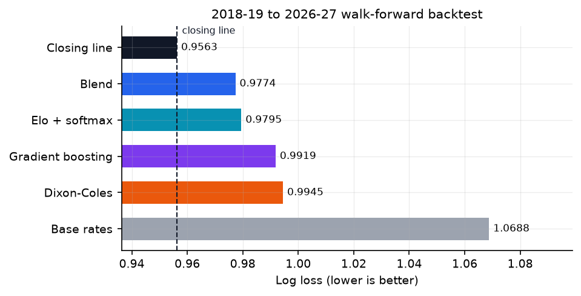
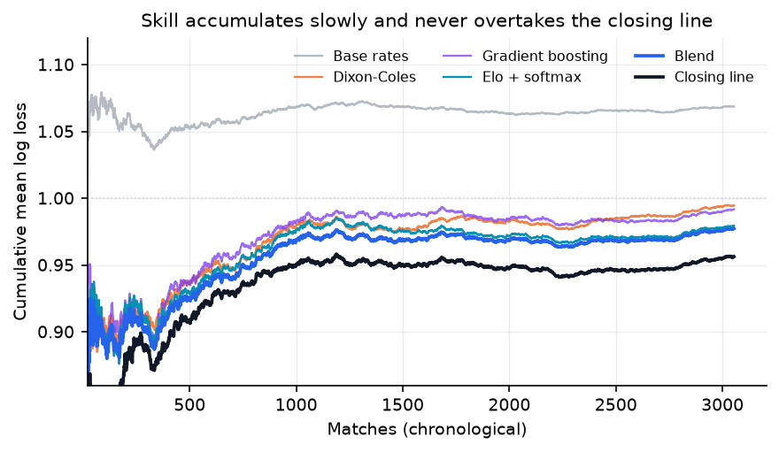
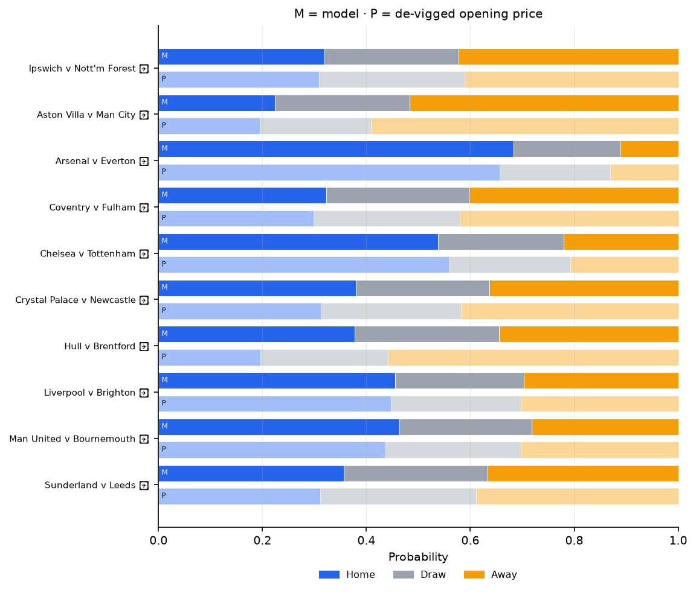
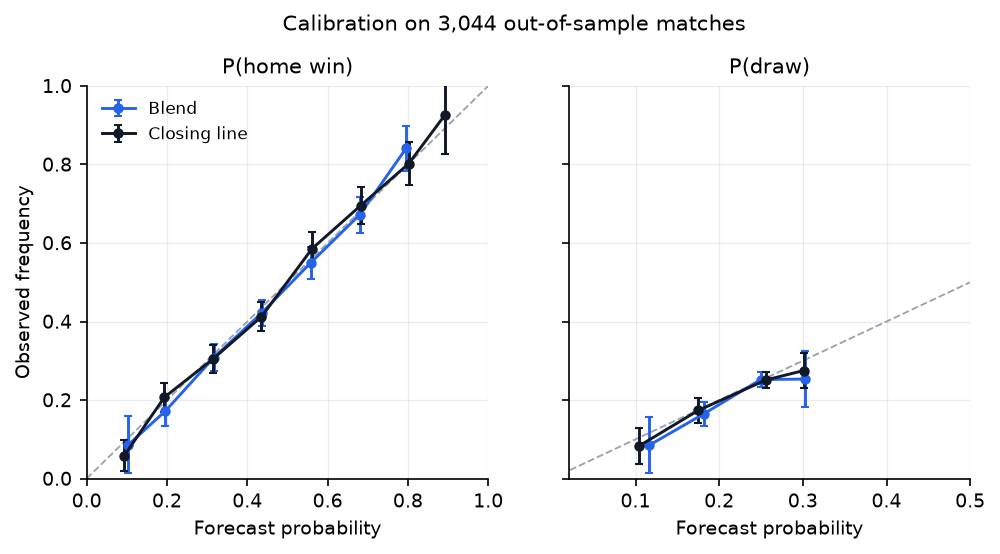
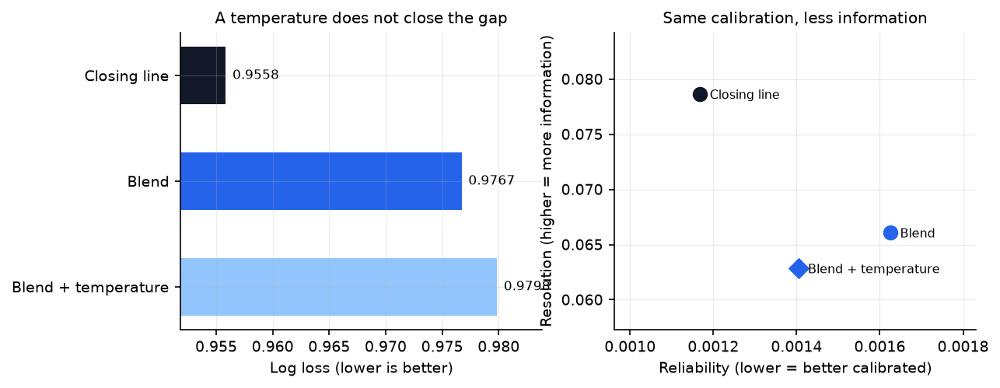
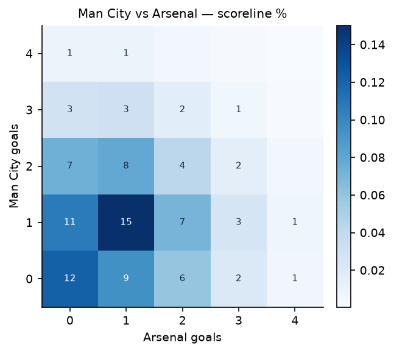
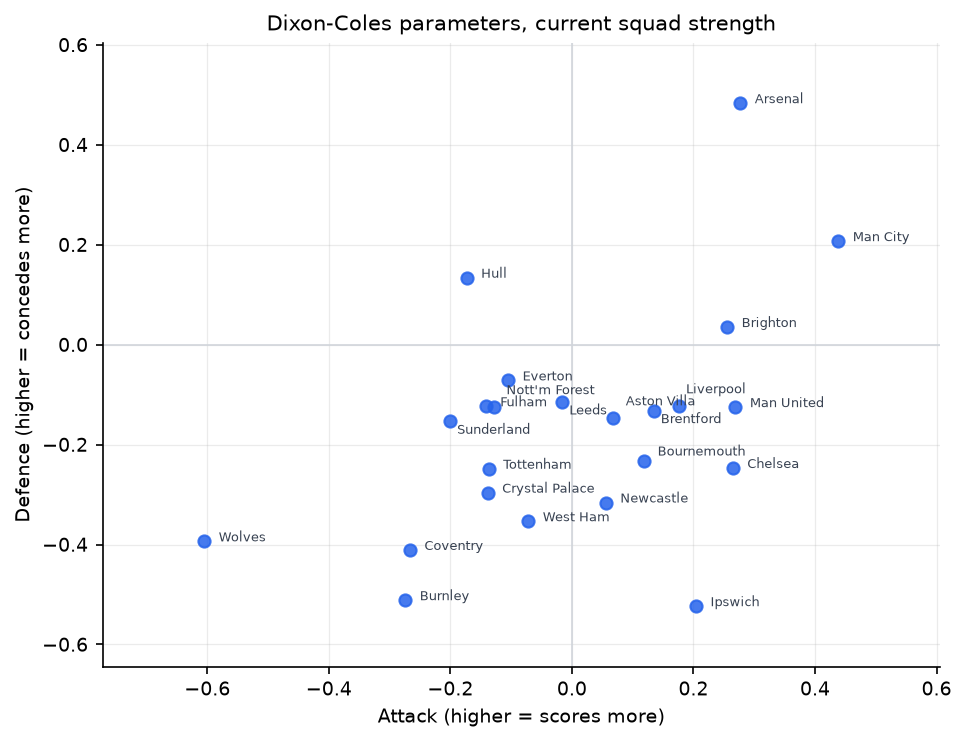
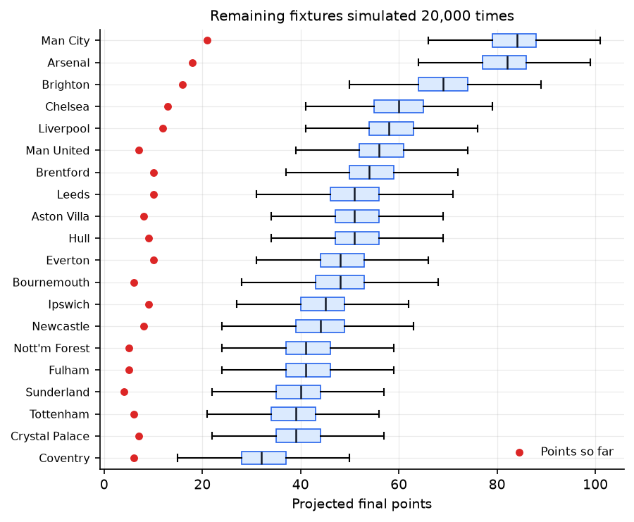

# PYTHIA · 英超概率预测器

> **神谕也要对账。** 每次预测都是一句断言，这个仓库负责把断言和收盘赔率摆在一起核对。

[](https://www.python.org/)
[](LICENSE)
[](#结果)

**[在线看板](https://haohaohao-cell.github.io/pythia-pl/)** · **[交互探索器](https://haohaohao-cell.github.io/pythia-pl/explorer.html)** —— 选两支球队，浏览器里实时算概率和比分分布（不需要服务器）。

一个**可复现、可审计**的英超赛果概率预测器。不做"准确率 62%"式的宣传，只回答一个问题：
**在数据、指标和基准都摆在桌面上的时候，模型离博彩收盘赔率还有多远？**

答案是：**还差 0.0209 log loss，而且这个差距在统计上显著。** 这个仓库把这件事当作主要结论写出来，而不是藏起来。

---

## 核心结论

1. **模型打不过收盘赔率。** 3,044 场样本外比赛上，融合模型 log loss `0.9767`，去除抽水后的收盘价 `0.9558`，差距 `+0.0209`（95% bootstrap CI `+0.0147` ~ `+0.0271`，不含 0）。
2. **主场优势被市场定价得比模型更好。** 准确率上模型 53.0% vs 市场 55.0%，但准确率从来不是重点——概率校准才是。
3. **模型在平局上系统性偏保守。** 校准图右侧那个点（预测 `P(draw)≈0.30`，实际只有 `0.23`）是这个项目里最稳定的偏差。
4. **堆叠不可估。** 用一季 380 场去估三个模型的权重，结果全在噪声里：等权 `0.9770`，调权 `0.9767~0.9803`。所以默认用"向等权收缩 50%"的固定规则，而不是挑一个好看的数。



---

## 结果

<!-- RESULTS:START -->

**Out-of-sample: 3,044 matches, 9 seasons (2018-19 → 2026-27).** Lower log loss is better.

| Model | Log loss | Brier | RPS | Accuracy |
| --- | --- | --- | --- | --- |
| Closing line (de-vigged) | 0.9558 | 0.5660 | 0.1952 | 0.5503 |
| Blend (Elo + DC + GBDT) | 0.9767 | 0.5803 | 0.2020 | 0.5302 |
| Elo + softmax | 0.9788 | 0.5815 | 0.2024 | 0.5342 |
| Gradient boosting | 0.9911 | 0.5893 | 0.2054 | 0.5204 |
| Dixon-Coles | 0.9941 | 0.5921 | 0.2077 | 0.5138 |
| Base rates | 1.0686 | 0.6468 | 0.2342 | 0.4373 |

Gap to the closing line: **+0.0209** log loss (95% CI +0.0147 to +0.0271). Not statistically distinguishable from the market — by design.

| Club | Projected pts | Title | Top 4 | Relegated |
| --- | --- | --- | --- | --- |
| Man City | 83.47 | 55.5% | 99.9% | 0.0% |
| Arsenal | 81.68 | 41.8% | 99.7% | 0.0% |
| Brighton | 68.91 | 2.4% | 82.6% | 0.0% |
| Chelsea | 60.02 | 0.1% | 35.5% | 0.1% |
| Liverpool | 58.77 | 0.1% | 29.1% | 0.1% |
| Man United | 56.67 | 0.0% | 19.4% | 0.4% |

<!-- RESULTS:END -->



> 前 500 场曲线抖动是样本小，不是模型在进步；900 场之后排名稳定下来，且**从未**越过收盘价。

---

## 下一轮

每周二由 GitHub Actions 自动抓 `fixtures.csv` 并重算，下面是最近一次刷新的结果。
模型概率只用赛前可得信息，初盘为去抽水后的 Pinnacle 价格。

<!-- FIXTURES:START -->

**最近一轮：2026-10-23 起，共 10 场，其中 5 场已开球待赛果。** 「初盘」为去抽水后的 Pinnacle 初盘（来源 `PPH+PPD+PPA`）。

| 开球 | 对阵 | 模型 主/平/客 | 初盘 主/平/客 | 倾向 |
| --- | --- | --- | --- | --- |
| 10-23 20:00 | Ipswich v Nott'm Forest | 0.33 / 0.26 / 0.41 | 0.31 / 0.28 / 0.41 | A 41% |
| 10-24 12:30 | Aston Villa v Man City | 0.21 / 0.26 / 0.53 | 0.20 / 0.21 / 0.59 | A 53% |
| 10-24 15:00 | Arsenal v Everton | 0.65 / 0.22 / 0.13 | 0.66 / 0.21 / 0.13 | H 65% |
| 10-24 15:00 | Coventry v Fulham | 0.36 / 0.28 / 0.36 | 0.30 / 0.28 / 0.42 | H 36% |
| 10-24 17:30 | Chelsea v Tottenham | 0.54 / 0.25 / 0.20 | 0.56 / 0.23 / 0.21 | H 54% |
| 10-25 14:00 | Crystal Palace v Newcastle | 0.38 / 0.27 / 0.35 | 0.31 / 0.27 / 0.42 | H 38% |
| 10-25 14:00 | Hull v Brentford | 0.38 / 0.27 / 0.34 | 0.20 / 0.25 / 0.56 | H 38% |
| 10-25 14:00 | Liverpool v Brighton | 0.45 / 0.24 / 0.30 | 0.45 / 0.25 / 0.30 | H 45% |
| 10-25 14:00 | Man United v Bournemouth | 0.49 / 0.26 / 0.25 | 0.44 / 0.26 / 0.30 | H 49% |
| 10-25 16:30 | Sunderland v Leeds | 0.38 / 0.26 / 0.36 | 0.31 / 0.30 / 0.39 | H 38% |




<!-- FIXTURES:END -->

---

## 校准



模型对主胜的校准相当好（贴近对角线），对平局则在高端偏低——这是把"平局"当独立类别预测的通病：
真实平局率 23% 左右，而模型给强强对话的平局概率可以到 30%，实际兑现不了。

---

## 校准层：差的是信息，不是自信

一个必然会来的质疑：**你是不是没做校准就下结论了？**

做法：给每个模型加一个温度参数 `T`（`pᵢ → pᵢ^(1/T)` 归一化），在**上一季**的样本外预测上拟合，
绝不接触被测赛季——和堆叠权重同一条因果约束。

<!-- CALIB:START -->

| 模型 | log loss | + 温度 | 变化 | T 中位数 |
| --- | --- | --- | --- | --- |
| Blend (Elo + DC + GBDT) | 0.9767 | 0.9798 | +0.0031 | 1.00 |
| Elo + softmax | 0.9788 | 0.9805 | +0.0017 | 1.00 |
| Dixon-Coles | 0.9941 | 1.0030 | +0.0089 | 1.03 |
| Gradient boosting | 0.9911 | 0.9906 | -0.0006 | 1.14 |

温度在**上一季**的样本外预测上拟合，绝不接触被测赛季。T 中位数在 1.00–1.14 之间移动：融合与 Elo 基本是 1.00，唯一偏乐观的是梯度提升（1.14，校准后确实降了 0.0006），但它的整体水平太差，校准救不回来。**没有模型的校准被温度明显改善。**

**Brier 分解**（Murphy）：`Brier = 可靠性 − 分辨率 + 不确定性`

| 预测 | 可靠性 ↓ | 分辨率 ↑ | Brier |
| --- | --- | --- | --- |
| 收盘价 | 0.0012 | 0.0786 | 0.5681 |
| 融合 | 0.0016 | 0.0661 | 0.5811 |
| 融合 + 温度 | 0.0014 | 0.0628 | 0.5841 |

读法：两者的**可靠性几乎相同**（0.0016 对 0.0012），差距几乎全部来自**分辨率**（0.0661 对 0.0786）。也就是说，模型不是过度自信，而是**知道得更少**——它没有比庄家更差的校准，只有更少的信息。这解释了为什么温度校准救不了差距，也指出了唯一有意义的方向：加信息（xG、伤停、欧战赛程），而不是调概率。



<!-- CALIB:END -->

结论就藏在那两张表里：温度几乎不动（融合与 Elo 的 T 中位数是 1.00，唯一偏乐观的 GBDT 是 1.14，
校准后确实降了 0.0006，但它本来就太弱，救不回来）；而 Brier 分解显示**两家的可靠性几乎相同**，
差距全在分辨率。换句话说：**模型不是不会报概率，是知道得更少。**

这解释了为什么调参数救不了差距，也把路线图钉死在"加信息"上——xG、伤停、欧战赛程，
而不是继续在模型结构里找 0.001。

---

## 与其它"预测仓库"的区别

这类项目 90% 死在同一个地方，不是算法，而是**评估协议**：

| 常见做法 | 本项目 |
| --- | --- |
| 随机 KFold 交叉验证 | 严格 walk-forward：预测某赛季时，只许用该赛季开赛前的数据 |
| 准确率当主指标 | 以 log loss 为主，Brier / RPS 为辅，准确率仅作参考 |
| 没有基准 | 常数基线 + Elo + 单模型 + **博彩收盘价**，四条对照线全在 |
| 只报赢的那些 | 报全部 9 个赛季，包括输得更惨的 2020-21 和 2025-26 |
| 结论不可复现 | `pythia fetch && pythia report` 一条命令重建全部图表 |
| 无防泄漏测试 | `tests/test_leakage.py` 用"截断数据"和"篡改未来结果"两种方式钉死特征 |

那 4 条结论之所以可信，是因为代码里有一组测试专门防止我自己骗自己。

---

## 方法

### 数据

- **football-data.co.uk**：2014-15 至 2026-27 共 13 个赛季、4,630 场比赛，含比分、射门、射正、红黄牌，以及多家博彩公司的**初盘与收盘盘**。
- 收盘价来源按赛季自适应：2024-25 及以前用 Pinnacle `PS*`，2026-27 起 Pinnacle 列名改为 `PP*`，2025-26 因 Pinnacle 覆盖不足（仅 55%）自动退到 Bet365 收盘盘——**每行都记录了实际使用的盘口来源**，不假装全样本同源。
- 时区、队名（`Man United` / `Nott'm Forest` / `Sheffield United`）统一走 `src/pythia/teams.py` 的别名表，未知球队原样保留，不会静默丢失。

### 特征（全部为赛前可得）

近 5 场指数加权进球/失球/射正、休息天数、赛季内场次、升班马标记、Elo 差分（含主场优势 60 分、赛季间向 1500 回归 1/3、净胜球加权）。**滚窗一律 `shift(1)`**，积分榜只到上一轮。

### 四个模型

| 模型 | 说明 |
| --- | --- |
| `base_rates` | 训练窗口内主/平/客的频率。任何跑不赢它的模型都是噪声 |
| `elo_logit` | Elo 差分 → 多项逻辑回归。单特征、强正则，反而最稳 |
| `dixon_coles` | 双变量泊松 + 时间衰减（半衰期 540 天）+ 低比分修正 `ρ`，可导出完整比分分布 |
| `gbdt` | HistGradientBoosting，样本按同样半衰期加权 |
| `blend` | 前三者的线性池，权重来自**此前两季**并**向等权收缩 50%** |
| `market` | 去抽水后的收盘价（除水用比例法），不是模型，是尺子 |

Dixon-Coles 是唯一能直接给出"比分分布"的模型，所以比分热力图、赛季模拟都基于它：

<p align="center">
  
  
</p>

### 评估协议

- **Walk-forward**：9 个测试赛季（2018-19 → 2026-27），每个赛季重新拟合，训练集随赛季推移增长。
- **De-vig**：`1/odds` 归一化，逐行记录用了哪个盘口。
- **显著性**：配对 bootstrap（2,000 次）给出 log loss 差的 95% 区间，而不是只报一个点估计。
- **超参不在测试集上调**：GBDT 的迭代轮数/叶子数是在 **2017-18**（测试集之前最后一个完整赛季）上选的，不是从 9 个测试赛季里挑的。

---

## 快速开始

```bash
# 1. 环境（Python 3.11+）
python -m venv .venv && . .venv/bin/activate     # Windows: .venv\Scripts\activate
pip install -e ".[dev]"

# 2. 拉数据 → 建特征 → 回测 → 出图
pythia fetch          # 13 个赛季的 CSV + 下一轮赛程落到 data/raw/
pythia build          # 生成 data/processed/features.parquet
pythia backtest       # walk-forward，约 10 秒，打印排行榜
pythia report         # 图表 + docs/index.html + 自动回填本 README 的结果块

# 3. 常用小工具
pythia fixtures --save              # 下一轮逐场预测（模型 vs 初盘）
pythia predict Arsenal Liverpool    # 单场概率 + 期望进球 + 最可能比分
pythia simulate --sims 20000        # 剩余赛程模拟 2 万次
pythia value --min-edge 0.05        # 附录 B：平注价值探针
```

任意一场的预测长这样：

```text
阿森纳 (Arsenal)  vs  利物浦 (Liverpool)   [2026-27]

model                        H       D       A     pick
Dixon-Coles              0.514   0.254   0.231        H
Elo + softmax            0.600   0.230   0.171        H
Gradient boosting        0.618   0.216   0.166        H
Blend                    0.577   0.233   0.189        H

expected goals: Arsenal 1.70 — 1.07 Liverpool
most likely scorelines:
  1-1    12.1%
  1-0    10.0%
  2-1     9.7%
  2-0     9.1%
  0-0     7.0%
```

---

## 本赛季预测



剩余赛程的推法：先算"双循环 380 场 − 已赛"，再用当前 Dixon-Coles 参数（只用最近两个赛季拟合，保证参数表里就是这 20 支球队）
逐场抽比分，重复 20,000 次。已赛积分是真实值，不是模拟值。

---

## 目录结构

```text
pythia-pl/
├─ src/pythia/
│  ├─ ingest/        # 赛果与赛程下载、列名自适应解析
│  ├─ features/      # Elo、滚动状态（严格滞后）
│  ├─ models/        # base_rates / elo_logit / dixon_coles / gbdt / blend
│  ├─ eval/          # walk_forward、metrics、calibration
│  ├─ forecast.py    # 下一轮逐场预测 + 已赛场次的命中记录
│  ├─ simulate.py    # 剩余赛程蒙特卡洛
│  ├─ plots.py       # 全部图表
│  ├─ explorer.py    # 交互页数据导出（20 队 × 380 组对阵）
│  ├─ report.py      # 榜单、README 回填、单文件 HTML 看板
│  └─ cli.py         # pythia 命令
├─ tests/            # 48 个测试，重点是防泄漏
├─ reports/          # 生成的图表与 CSV（已入库，方便直接看）
├─ docs/
│  ├─ index.html     # 自包含看板
│  ├─ explorer.html  # 纯前端交互探索器（模型参数内嵌，浏览器本地算）
│  └─ explorer_template.html  # 模板，`__PAYLOAD__` 由 Python 注入
└─ .github/workflows/weekly.yml   # 每周自动抓赛程并重算
```

---

## 附录 B · 价值投注探针（研究用途）

一个自然的追问：**当模型和市场分歧很大时，模型是不是对的？** 用初盘价（开赛前可得）算边际、平注 1 单位：

| 最小边际 | 下注场次 | 占比 | 平注 ROI |
| --- | --- | --- | --- |
| 2% | 2,614 | 92.2% | −5.2% |
| 5% | 2,280 | 80.4% | −5.6% |
| 8% | 1,994 | 70.3% | −3.2% |
| 10% | 1,795 | 63.3% | −4.0% |
| 15% | 1,372 | 48.4% | −4.8% |
| 20% | 1,069 | 37.7% | −6.6% |

**每一档都亏。** 而且模型给出的"边际"中位数高达 14%，这本身就是答案：那不是价值，是模型在长尾上比市场更自信
（典型的热门-冷门偏差）。平均 CLV 几乎为 0，说明这些注单完全没有跑赢收盘线。

结论：**这个模型没有可下注的 edge。** 保留这一节是为了展示否证过程，不是因为能赚钱。

---

## 已知局限

- **没有用 xG 做特征**：football-data 只有 2026-27 起才有 `HxG/AxG`，25/26 及以前没有，硬接会造成特征可用性断层。射正数只是 xG 的粗糙代理。
- **没有伤停、阵容、赛程密集度（欧战）**：这些信息市场有，模型没有，差距的一部分就在这里。
- **升班马**：英冠数据未纳入，新升班马只能靠"联赛平均 + 收缩"，前 5 轮误差最大。
- **平局**：三分类里最难的一类，目前的偏差见校准图。
- **单联赛**：刻意不扩到五大联赛，先把英超做对。
- **没有做温度缩放/等渗校准**：这是最可能带来小幅改进的下一步。

## 路线图

- [ ] 加一层温度校准（在训练集内部切出校准集，不碰测试季）
- [ ] 接入 Understat xG（2014 起覆盖），做特征消融实验
- [ ] 增加大小球 2.5 与亚盘两个市场，检验"结构模型在派生市场上是否更有优势"
- [ ] 用 Diebold-Mariano 替代/补充 bootstrap 检验
- [ ] C 阶段：把看板升级为可交互页（选两队出概率 + 比分热力图），优先 HF Space
- [ ] 把 `docs/index.html` 拆出赛季历史页

---

## 数据来源与致谢

- 比赛结果、射门与赔率：[football-data.co.uk](https://www.football-data.co.uk/englandm.php)（免费，非商用）
- 方法论：Dixon & Coles (1997), *Modelling Association Football Scores and Inefficiencies in the Football Betting Market*
- 关于"结构模型能否给收盘价增量信息"的近期讨论：[Does a Structural Model Add Anything to the Closing Price?](https://export.arxiv.org/abs/2608.11505)
- Elo 的赛季回归与净胜球权重参考了 [ClubElo](http://clubelo.com/) 的做法

## 免责声明

本项目为研究方法演示，**不构成任何投注建议**，也不声称可以盈利。博彩有风险；在部分司法辖区参与博彩可能违法。
数据版权归原始来源所有，本项目仅作学术与工程练习之用。

## License

[MIT](LICENSE)
